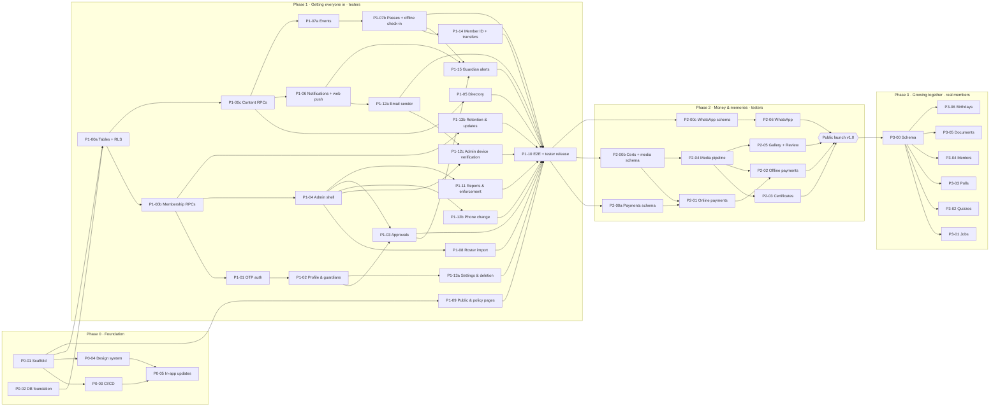

# 03 — Roadmap

There are four phases.

- **Phases 1–2 are testers only.** Real members join at the **public launch (v1.0)**, which sits between Phase 2 and Phase 3.
- **Schema comes first.** Each phase opens with its schema briefs (`Px-00*`). They land the tables, RLS, RPCs and tests that the rest of the phase builds on. After that, feature briefs run **in parallel**, each in its own folders.

Sizes: **S** ≈ one focused agent session, **M** ≈ 1–2 sessions. There are no calendar dates. Progress is gated by `02-owner-setup.md`.

## Dependency map

## Parallel waves (max 4 makers at once)

| Wave | Run together | Notes |
|---|---|---|
| 0a | P0-01 ∥ P0-02 | Separate folders |
| 0b | P0-03 ∥ P0-04 ∥ P1-09 | P1-09 is static pages; it only needs P0-01 and P0-04 |
| 1a | P1-00a ∥ P0-05 | P1-00a is the only schema brief; P0-05 (in-app updates) touches app files only |
| 1b | P1-00b ∥ P1-00c | Different functions and seed files. The orchestrator regenerates types at merge |
| 1c | P1-01 ∥ P1-04 ∥ P1-05 ∥ P1-07a | |
| 1d | P1-02 ∥ P1-06 ∥ P1-07b ∥ P1-08 | |
| 1e | P1-12a ∥ P1-12b ∥ P1-13b ∥ P1-03 | P1-03 needs P1-02 and P1-04 |
| 1f | P1-11 ∥ P1-13a ∥ P1-12c ∥ P1-14 | P1-12c needs P1-12a; P1-14 needs P1-07b |
| 1g | P1-15 | Needs P1-03, P1-06 and P1-07b |
| 1h | P1-10 | Alone. Cuts tester release `v0.5.0` |
| 2a | P2-00a ∥ P2-00b ∥ P2-00c | Separate table groups and seed files |
| 2b | P2-01 ∥ P2-04 ∥ P2-06 | |
| 2c | P2-02 ∥ P2-03 ∥ P2-05 | |
| Launch | Public launch gate (`phase-2 … #p2-99`) | Owner Stage C must be complete |
| 3a | P3-00 | Alone |
| 3b | P3-01 ∥ P3-02 ∥ P3-03 ∥ P3-04, then P3-05 ∥ P3-06 | |

## Milestones

| Milestone | Done when | Release | Who uses it |
|---|---|---|---|
| **M0 Foundation** | CI is green, a signed APK/AAB is on a GitHub Release, the web preview is live | `v0.1.0` | Team (from v0.1.1, phones update themselves) |
| **M1 Tester build** | Phase 1 is complete and the E2E suites are green | `v0.5.0` | Testers (internal Play track or APK) |
| **M2 Tester build 2** | Phase 2 is complete. Payments run in Razorpay test mode, certificates are issued and verified, the gallery works, a WhatsApp test campaign has been sent | `v0.9.0` | Testers |
| **M3 Public launch** | The launch gate has passed (D-U-N-S, Play listing, KYC pages approved, Razorpay live, lawyer check, restore test) | `v1.0.0` | **All members**: Play Store + web |
| **M4 Community** | Phase 3 features are live | `v1.x` → `v2.0.0` | All members |
| **Later** | iOS app, branch chat, elections, parent-organisation (35+) features | — | |

## What each phase waits on from the owner

| Phase | Can build without | Can't release without |
|---|---|---|
| 0 | — | A1–A6 |
| 1 | WhatsApp/MSG91 (test numbers work); AIAIA's email account (the email driver is mocked locally) | B1/B2 (real OTP for testers), B3, B4 |
| 2 | Razorpay live keys (test mode works); final designs (placeholders) | Spaces buckets (A3) |
| **Launch** | — | **All of Stage C** |
| 3 | — | Stage D content |

## Brief index

| ID | Title | Size | Maker | Review | Link |
|---|---|---|---|---|---|
| P0-01 | Monorepo scaffold | M | Sonnet | Sonnet | [phase-0](briefs/phase-0-foundation.md#p0-01) |
| P0-02 | DB foundation + RLS harness | M | Opus | Opus | [phase-0](briefs/phase-0-foundation.md#p0-02) |
| P0-03 | CI/CD, APK/AAB, web, backups | M | Sonnet | Opus | [phase-0](briefs/phase-0-foundation.md#p0-03) |
| P0-04 | Design system | M | Sonnet | Sonnet | [phase-0](briefs/phase-0-foundation.md#p0-04) |
| P0-05 | In-app updates (tester self-update + store redirect) | M | Sonnet | Sonnet | [phase-0](briefs/phase-0-foundation.md#p0-05) |
| P1-00a | Phase-1 tables + RLS | M | Opus | Opus | [phase-1](briefs/phase-1-core.md#p1-00a) |
| P1-00b | Membership & roles RPCs | M | Opus | Opus | [phase-1](briefs/phase-1-core.md#p1-00b) |
| P1-00c | Content & operations RPCs | M | Opus | Opus | [phase-1](briefs/phase-1-core.md#p1-00c) |
| P1-01 | Phone OTP auth | M | Sonnet | Opus | [phase-1](briefs/phase-1-core.md#p1-01) |
| P1-02 | Profile, minors, guardians, waiting room | M | Sonnet | Sonnet | [phase-1](briefs/phase-1-core.md#p1-02) |
| P1-03 | Approvals | M | Sonnet | Sonnet | [phase-1](briefs/phase-1-core.md#p1-03) |
| P1-04 | Admin shell, members, roles, audit | M | Sonnet | Sonnet | [phase-1](briefs/phase-1-core.md#p1-04) |
| P1-05 | Directory | S | Sonnet | Sonnet | [phase-1](briefs/phase-1-core.md#p1-05) |
| P1-06 | Announcements, notifications, push, web push, PWA | M | Sonnet | Sonnet | [phase-1](briefs/phase-1-core.md#p1-06) |
| P1-07a | Events, RSVP, reminders | M | Sonnet | Sonnet | [phase-1](briefs/phase-1-core.md#p1-07a) |
| P1-07b | Delegate passes & offline check-in | M | Sonnet | Opus | [phase-1](briefs/phase-1-core.md#p1-07b) |
| P1-08 | Roster import/export | S | Sonnet | Sonnet | [phase-1](briefs/phase-1-core.md#p1-08) |
| P1-09 | Public website & policy pages | S | Sonnet | Sonnet | [phase-1](briefs/phase-1-core.md#p1-09) |
| P1-10 | E2E + tester release | M | Sonnet | Sonnet | [phase-1](briefs/phase-1-core.md#p1-10) |
| P1-11 | Reporting & enforcement | M | Sonnet | Opus | [phase-1](briefs/phase-1-core.md#p1-11) |
| P1-12a | Email: official sender, verification, channel | M | Sonnet | Sonnet | [phase-1](briefs/phase-1-core.md#p1-12a) |
| P1-12c | Super-admin device verification (once per device) | M | Sonnet | Opus | [phase-1](briefs/phase-1-core.md#p1-12c) |
| P1-12b | Support: phone-number change | S | Sonnet | Opus | [phase-1](briefs/phase-1-core.md#p1-12b) |
| P1-13a | Settings, data export, account deletion | S | Sonnet | Opus | [phase-1](briefs/phase-1-core.md#p1-13a) |
| P1-13b | Retention purge | S | Sonnet | Opus | [phase-1](briefs/phase-1-core.md#p1-13b) |
| P1-14 | Digital member ID & branch transfers | M | Sonnet | Sonnet | [phase-1](briefs/phase-1-core.md#p1-14) |
| P1-15 | Minor safety: guardian check-in alerts | S | Sonnet | Opus | [phase-1](briefs/phase-1-core.md#p1-15) |
| P2-00a | Payments schema + helpers | M | Opus | Opus | [phase-2](briefs/phase-2-money-memories.md#p2-00a) |
| P2-00b | Certificates + media schema, storage & PDF | M | Opus | Opus | [phase-2](briefs/phase-2-money-memories.md#p2-00b) |
| P2-00c | WhatsApp schema + RPCs | S | Opus | Opus | [phase-2](briefs/phase-2-money-memories.md#p2-00c) |
| P2-01 | Online payments | M | Sonnet | Opus | [phase-2](briefs/phase-2-money-memories.md#p2-01) |
| P2-02 | Offline payments & treasurer | M | Sonnet | Sonnet | [phase-2](briefs/phase-2-money-memories.md#p2-02) |
| P2-03 | Certificates (templates + on-demand render) | M | Sonnet | Sonnet | [phase-2](briefs/phase-2-money-memories.md#p2-03) |
| P2-04 | Media pipeline (Spaces) | M | Sonnet | Opus | [phase-2](briefs/phase-2-money-memories.md#p2-04) |
| P2-05 | Gallery + Review archive | M | Sonnet | Sonnet | [phase-2](briefs/phase-2-money-memories.md#p2-05) |
| P2-06 | Official WhatsApp messaging | M | Sonnet | Opus | [phase-2](briefs/phase-2-money-memories.md#p2-06) |
| — | Public launch gate | — | orchestrator + owner | — | [phase-2](briefs/phase-2-money-memories.md#p2-99) |
| P3-00 | Phase-3 schema | M | Opus | Opus | [phase-3](briefs/phase-3-community.md#p3-00) |
| P3-01 | Jobs & opportunities | S | Sonnet | Sonnet | [phase-3](briefs/phase-3-community.md#p3-01) |
| P3-02 | Quizzes, leaderboards, badges | M | Sonnet | Sonnet | [phase-3](briefs/phase-3-community.md#p3-02) |
| P3-03 | Polls | S | Sonnet | Sonnet | [phase-3](briefs/phase-3-community.md#p3-03) |
| P3-04 | Mentorship | S | Sonnet | Sonnet | [phase-3](briefs/phase-3-community.md#p3-04) |
| P3-05 | Document library | S | Sonnet | Sonnet | [phase-3](briefs/phase-3-community.md#p3-05) |
| P3-06 | Birthday shout-outs | S | Sonnet | Sonnet | [phase-3](briefs/phase-3-community.md#p3-06) |
